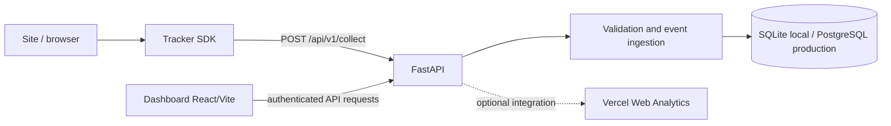

# Nexo Analytics

Painel privado para consultar eventos coletados pelo portfólio e, quando configurado, métricas agregadas do Vercel Web Analytics. O projeto reúne um dashboard React/Vite, uma API Python/FastAPI e um tracker JavaScript sem dependência de framework.

## Arquitetura

## Arquitetura



```text
apps/dashboard/             React + Vite: login e painel administrativo
services/api/               FastAPI: autenticação, analytics e ingestão
  app/routers/               endpoints separados por responsabilidade
  app/database/              inicialização e acesso ao armazenamento
packages/tracker-sdk/       tracker JavaScript independente do framework
docs/                       guias de integração, API e privacidade
```

Fluxo próprio: navegador do site → tracker → `POST /api/v1/collect` → API valida e armazena eventos → dashboard consulta dados agregados. Em paralelo, a API pode consultar Vercel Web Analytics se estiver configurada. As fontes são apresentadas separadamente; pageviews da Vercel e do tracker não devem ser somados como se fossem a mesma série.

A API expõe `GET /health`; durante desenvolvimento, a documentação FastAPI fica em `/docs`.

## Métricas e semântica

- **Eventos próprios:** pageviews, interações instrumentadas e duração visível de página.
- **Duração:** a contagem pausa quando a aba fica oculta e é enviada na mudança de rota ou saída; páginas que continuam abertas podem ainda não ter uma amostra final.
- **Sessão:** identificador temporário por aba, não uma identidade persistente de pessoa.
- **Dispositivo, navegador e sistema:** categorias aproximadas inferidas no cliente, não contagem garantida de aparelhos físicos únicos.
- **Região:** aproximação baseada em dados agregados da Vercel ou cabeçalhos de proxy confiável configurado. A API local não determina localização precisa.
- **Privacidade:** o tracker evita enviar IP, referenciador, valores de formulário, query strings e fragmentos, e respeita Do Not Track. Isso não substitui uma política de privacidade adequada à implantação.

## Persistência e ambiente

SQLite é usado no desenvolvimento local. A configuração de produção exige PostgreSQL durável e uma configuração de sessão forte; a API verifica essas condições ao iniciar em modo de produção. O e-mail administrativo e o hash de senha são configurados no ambiente, e não por uma tela de criação de contas.

## Requisitos

- Node.js/npm
- Python 3.11+
- PostgreSQL para produção

## Executar localmente (PowerShell)

Na raiz, copie `.env.example` para `.env` e configure as variáveis locais. Instale e inicie a API:

```powershell
cd services/api
py -m venv .venv
.venv\Scripts\Activate.ps1
py -m pip install -r requirements.txt
py -m app.hash_password
uvicorn app.main:app --reload --host 127.0.0.1 --port 8000
```

Em outro terminal:

```powershell
cd apps/dashboard
npm install
npm run dev
```

Abra `http://localhost:5173`; a API fica em `http://127.0.0.1:8000`. Configure as origens CORS para os endereços reais usados no navegador.

## Conectar ao LV_Portfolio

O SDK está em `packages/tracker-sdk/src/index.js`; o portfólio mantém um adaptador em `src/lib/nexo-tracker.js`. Para coleta de produção, a API deve estar publicada em HTTPS e o portfólio deve receber `VITE_NEXO_COLLECT_URL` e `VITE_NEXO_SITE_ID` no ambiente de build. O backend deve permitir a origem do site. Não exponha configuração privada do servidor em variáveis destinadas ao frontend.

Guia: [docs/INTEGRATION_TRACKER.md](docs/INTEGRATION_TRACKER.md).

## Critérios de produção

- Persistência PostgreSQL durável e política de retenção definida.
- Configuração forte de sessão e restrição de origens permitidas.
- Endpoint público HTTPS para coleta de eventos.
- Configuração Vercel apenas se a integração com Vercel Web Analytics for necessária.
- Validar o health check, autenticação e coleta no ambiente publicado.

Este README descreve a arquitetura e a configuração do código; não afirma que exista uma implantação pública de produção ativa.

**Autor:** Luca Toniolo — [@Lvc4br](https://github.com/Lvc4br)
