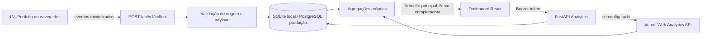

# Arquitetura do Nexo Analytics

## Componentes implementados

- **Dashboard** (`apps/dashboard`): React JSX e Vite. Solicita relatórios protegidos ao backend e mostra estado das fontes, métricas e insights.
- **API** (`services/api`): Python/FastAPI. Autentica o administrador, recebe eventos, persiste a coleta própria, consulta a API Web Analytics da Vercel e calcula o relatório.
- **Tracker** (`packages/tracker-sdk`): JavaScript ESM sem dependências. Coleta pageviews e interações permitidas no navegador do portfólio.
- **Banco**: SQLite local para desenvolvimento; PostgreSQL persistente obrigatório em produção.

O tracker fica no código do site monitorado e aponta para a API Nexo. Essa separação deixa a coleta própria independente do provedor que hospeda o portfólio. A consulta da Vercel é um adaptador opcional de agregados, não uma dependência do coletor.

## Fluxo de coleta

1. O tracker cria um `event_id` e mantém um `session_id` aleatório em `sessionStorage`.
2. Envia `event_name`, `path`, `site_id`, `session_id` e `event_id` por HTTPS.
3. O coletor confere origem permitida, ID do site e formato, aplica limite local, remove duplicatas e persiste o evento.
4. A consulta autenticada agrega eventos Nexo para o período escolhido.
5. Se as credenciais Vercel existirem e a API estiver acessível, o backend usa os pageviews e visitantes diários da Vercel como fonte principal; se a chamada falhar, usa o tracker como fallback.
6. A resposta mantém eventos customizados Vercel e Nexo em listas separadas. Pageviews não são somados, evitando duplicidade.

## Camada própria e métricas

O tracker reconhece pageviews iniciais e transições de `history.pushState`, `history.replaceState` e `popstate`. Eventos profissionais como `resume_open` e `contact_click` são opt-in pelo código do portfólio. O dashboard calcula taxa de engajamento como sessões Nexo com ao menos um evento personalizado dividido por sessões Nexo do período.

As sessões são uma estimativa baseada em armazenamento por aba; não são pessoas únicas e não podem ser associadas à agregação Vercel. Uma sessão pode conter mais de uma página; o ID não é persistente entre abas independentes nem identifica uma pessoa.

## Falha e portabilidade

- Sem configuração Vercel: relatório responde com dados Nexo, inclusive vazio enquanto nenhum evento chegar.
- Erro da API Vercel: o backend mantém relatório disponível com dados Nexo e informa estado da fonte.
- Portfólio hospedado em outro provedor: mantenha o endpoint Nexo e acrescente a origem nova a `PORTFOLIO_ALLOWED_ORIGINS`.
- API Nexo em produção: use PostgreSQL, pois sistemas serverless não oferecem disco local durável.

Os dados agregados da Vercel não são importados automaticamente para o banco Nexo. Se a Vercel for desconectada, históricos próprios do Nexo continuam disponíveis enquanto não expirarem.

## Limites operacionais desta versão

- Um site de portfólio configurado por `PORTFOLIO_SITE_ID`.
- Um administrador configurado por ambiente.
- O limite de eventos em memória é local a um processo; produção distribuída precisa de limitação compartilhada no gateway.
- O schema é inicializado com `create_all`; alterações futuras que exigirem migração devem adicionar ferramenta de migrations antes de evolução incompatível.
- Não há geolocalização, identificação de empresas, visitantes individuais ou rastreamento de conteúdo de página.
